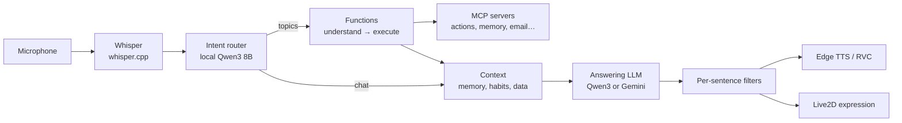

# Pixelgami

[](https://github.com/Z3E-Brian/pixelgami/actions/workflows/pruebas.yml)

[Español](README.md) · **English**

*Pixel + kami (神, spirit): like the tsukumogami of Japanese folklore, objects that gain a soul over the years,
but on your PC.*

A desktop assistant with a body: a Live2D character that lives in a corner of your screen, listens to you, answers
with a voice and does things on your PC (opens apps and games, moves and closes windows, searches the web, reads
your email, plays music, remembers what you tell her). She shows up and hides with a keyboard shortcut.

It is built on top of [Open-LLM-VTuber](https://github.com/Open-LLM-VTuber/Open-LLM-VTuber) (the backend) and its
desktop client, plus its own layer: automatic context, memory and diary, MCP tools, voice and the "pet mode" for
Linux. The brain runs locally with [Ollama](https://ollama.com) (Qwen3 8B) or with the free Gemini API.

The sample character is called **IA-chan** and uses the **Mao** model (an official Live2D sample, bundled with
Open-LLM-VTuber). Swapping the model, the voice or the name is configuration: see [docs/MODELOS.md](docs/MODELOS.md)
and [docs/VOCES.md](docs/VOCES.md).

> The project is developed in Spanish: the code, the docs and the assistant itself speak Spanish. This page is an
> overview; the guides in `docs/` are in Spanish.

## What it does

- **Talks and listens**: Whisper (whisper.cpp) to understand you, Edge TTS to speak; optional custom voice with RVC.
- **Understands what you ask, however you say it**: a "router" running on the local model decides whether you are
  talking about windows, email, music, the web, your PC or just chatting, and prepares the data before answering.
- **Does things**: opens apps (through their `.desktop` file), Steam games and projects in VS Code; moves and closes
  windows (Hyprland); tells you how much RAM, disk or GPU you are using; searches the web (SearXNG or DuckDuckGo)
  and opens results.
- **Email and calendar** (optional): Gmail over IMAP with an app password; only reversible actions (read, mark,
  archive, move to spam or trash; never delete permanently, never send).
- **Music** (optional): YouTube Music Desktop App through its Companion Server.
- **Memory**: what you ask her to remember, what she learns on her own about how you like things, and a diary of
  her days with you.
- **Reminders** (optional): "remind me tomorrow at 3…" by voice or in a small window; she notifies you even when she
  is turned off, and can read and add events to Google Calendar.
- **Faces**: every answer carries emotions (`[joy]`, `[shy]`…) that become expressions of the Live2D model
  ([docs/EXPRESIONES.md](docs/EXPRESIONES.md)); she reacts if you touch her head or cheek.

## What comes from Open-LLM-VTuber and what this project adds

| From [Open-LLM-VTuber](https://github.com/Open-LLM-VTuber/Open-LLM-VTuber) (upstream, unchanged) | Added by this project |
|---|---|
| The server (WebSocket), turn-based conversation, history and the agent that calls the LLM | The **intent router** and the automatic context (`agent/asistente_contexto.py`) |
| Connectors for Ollama, Gemini and other LLMs; Edge TTS; the MCP client | The **8 functions** in `funciones/` and how they are loaded (`funcion.yaml` + `funcion.py`) |
| The desktop client (Electron + React) and the Live2D renderer | The **5 MCP servers** (`*-mcp/`): actions, memory with embeddings, Google, music, Claude |
| | Memory, diary and self-learning (`agent/asistente_diario.py`) |
| | Whisper through `whisper.cpp` on the GPU, RVC voice, per-sentence filters (filler questions, face per sentence, made-up data) |
| | Pet mode on Linux/Hyprland (clipped window shape, gaze, touches) and the `escritorio/` scripts |
| | Tests (unittest and with the model), router metrics, CI, installer and documentation |

Changes to upstream files are few and are kept as patches (`parches/*/cambios.patch`, the hooks that call into
this project's code); new files live in `parches/*/nuevos/`.

How a sentence travels:



## Install

The step-by-step guide (meant to be followed by hand or handed to an agent) is in
**[docs/INSTALAR.md](docs/INSTALAR.md)**. In short:

```bash
git clone <this repo> ~/.local/share/pixelgami
cd ~/.local/share/pixelgami
./instalar.sh            # clones Open-LLM-VTuber and the client, applies the patches, creates the config
./instalar.sh --todo     # also: Python dependencies, Ollama and Whisper models, and builds the client
```

Then: [docs/CONECTAR.md](docs/CONECTAR.md) for the brain, the voice, email, music and the keyboard shortcut.

## Environment it was developed on

It was written and is used daily on this machine; on other setups some parts change:

| | Here | Elsewhere |
|---|---|---|
| Distro | CachyOS (Arch), kernel 7.x | Any Linux with Python 3.10+, Node and systemd. Package names differ (on Debian/Ubuntu, whisper.cpp is built from source). |
| Desktop | **Hyprland** with **Lua** config (dots-hyprland), Wayland | The shortcut, moving/closing windows and placing the character use `hyprctl`. The scripts also support the classic `hyprland.conf` (**untested**). On GNOME/KDE chat, voice, email, music and opening apps work; the window tools do not. |
| Window | Electron through **XWayland** (`--ozone-platform=x11`) | Needed so that only the character receives clicks (clipped shape). |
| GPU | AMD RX 6700 XT: Ollama on **Vulkan**, Whisper on Vulkan, RVC on ROCm (`HSA_OVERRIDE_GFX_VERSION`) | NVIDIA: Ollama uses CUDA on its own; whisper.cpp and torch need their CUDA builds. Without a GPU it works, slower. |
| Memory | 16 GB RAM + zram, **systemd-oomd** enabled | That is why everything is launched in `app.slice` scopes: if RAM runs out, oomd closes the assistant and not the session. |
| Shell | fish / zsh (the scripts are bash) | Same. |

## Layout

```
identidad.py, perfil.yaml   who is who: names (conf.yaml), gender, location, browser, email, aliases…
servidor.sh, entorno.sh     starts the backend, Whisper and RVC; settings specific to your PC
parches/                    changes on top of Open-LLM-VTuber and its client (BASE = repo and commit, cambios.patch, nuevos/)
*-mcp/                      MCP tools: actions, memory, google (email/calendar), music, claude
rvc/                        RVC voice server (optional)
escritorio/                 Hyprland scripts: show/hide, shut down, restart
herramientas/               agregar-modelo.py (adapt a Live2D model), nueva-funcion.py, comprobar.py
funciones/                  what she can do, one folder per function (windows, email, music, web…)
datos/                      what the functions store (not part of the repo)
pruebas_intencion.py        tests with the model: router and functions (see docs/FUNCIONES.md, "Probarlas")
evaluacion/                 router metrics: accuracy per topic, confusion matrix, timings -> resultados/
docs/                       install, connect, models, expressions, voices, writing functions and tools
```

## Tests

```bash
python3 -m unittest discover -p "test_*.py"                                   # no model needed (what CI runs)
cd Open-LLM-VTuber && uv run python ../pruebas_intencion.py --solo-router     # router with the model + metrics report
```

## Contributing

Issues, ideas and PRs are welcome: see [CONTRIBUTING.md](CONTRIBUTING.md) (in Spanish). Releases are under
*Releases* and the changes in each one are in [CHANGELOG.md](CHANGELOG.md). Always install a released version: the
development branch may be halfway through something.

## Licenses

- This repo's own code: **MIT** ([LICENSE](LICENSE)).
- The patches on Open-LLM-VTuber (backend) follow its MIT license. The patches on the **desktop client** follow its
  *Open-LLM-VTuber License 1.0* (Apache 2.0 with conditions): free for personal, educational and streaming use;
  commercial uses such as reselling it or redistributing it under another brand need a license from its authors.
- **Mao** and the other Live2D samples: Live2D's *Free Material License* (free for individuals and small companies;
  appropriate content). Every model you download comes with its own terms: check them.
- Voices: Edge TTS is a Microsoft service; RVC models carry the license of whoever made them (do not use the voices
  of real people without their permission).
