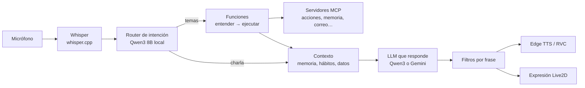

# Pixelgami

[](https://github.com/Z3E-Brian/pixelgami/actions/workflows/pruebas.yml)

**Español** · [English](README.en.md)

*Pixel + kami (神, espíritu): como los tsukumogami del folclore japonés, los objetos que cobran
alma con los años, pero en tu PC.*

Una asistente de escritorio con cuerpo: un personaje Live2D que vive en una esquina de tu pantalla,
te escucha, te responde con voz y hace cosas en tu PC (abrir apps y juegos, mover y cerrar ventanas,
buscar en internet, leer tu correo, poner música, recordar lo que le cuentas). Aparece y se oculta
con un atajo de teclado.

Está construida sobre [Open-LLM-VTuber](https://github.com/Open-LLM-VTuber/Open-LLM-VTuber) (el
backend) y su cliente de escritorio, más una capa propia: contexto automático, memoria y diario,
herramientas MCP, voz y el "modo mascota" para Linux. El cerebro corre en local con
[Ollama](https://ollama.com) (Qwen3 8B) o con la API gratuita de Gemini.

El personaje de ejemplo se llama **IA-chan** y usa el modelo **Mao** (muestra oficial de Live2D, viene incluida
en Open-LLM-VTuber).
Cambiarlo por otro modelo, otra voz u otro nombre es configuración: ver [docs/MODELOS.md](docs/MODELOS.md)
y [docs/VOCES.md](docs/VOCES.md).

## Qué hace

- **Habla y escucha**: Whisper (whisper.cpp) para entenderte, Edge TTS para hablar; voz propia opcional con RVC.
- **Entiende lo que pides aunque lo digas a tu manera**: un "router" con el modelo local decide si
  hablas de ventanas, correo, música, internet, tu PC o es charla, y prepara los datos antes de responder.
- **Hace cosas**: abre apps (por su `.desktop`), juegos de Steam y proyectos en VS Code; mueve y cierra
  ventanas (Hyprland); dice cuánta RAM, disco o GPU usas; busca en internet (SearXNG o DuckDuckGo) y abre resultados.
- **Correo y calendario** (opcional): Gmail por IMAP con contraseña de aplicación; solo acciones reversibles
  (leer, marcar, archivar, mover a spam o papelera; nunca borrar para siempre ni enviar).
- **Música** (opcional): YouTube Music Desktop App por su Companion Server.
- **Memoria**: lo que le pides recordar, lo que aprende sola de cómo te gustan las cosas, y un diario de sus días contigo.
- **Recordatorios** (opcional): "recuérdame mañana a las 3…" por voz o en una ventanita; avisa con una
  notificación aunque la asistente esté apagada, y puede leer y apuntar en Google Calendar.
- **Caras**: cada respuesta trae emociones (`[joy]`, `[shy]`…) que se vuelven expresiones del modelo Live2D
  ([docs/EXPRESIONES.md](docs/EXPRESIONES.md)); reacciona si le tocas la cabeza o la mejilla.

## Qué es de Open-LLM-VTuber y qué es de este proyecto

| De [Open-LLM-VTuber](https://github.com/Open-LLM-VTuber/Open-LLM-VTuber) (upstream, sin cambios) | De este proyecto |
|---|---|
| El servidor (WebSocket), la conversación por turnos, el historial y el agente que llama al LLM | El **router de intención** y el contexto automático (`agent/asistente_contexto.py`) |
| Los conectores a Ollama, Gemini y otros LLM; Edge TTS; el cliente MCP | Las **8 funciones** de `funciones/` y cómo se cargan (`funcion.yaml` + `funcion.py`) |
| El cliente de escritorio (Electron + React) y el render Live2D | Los **5 servidores MCP** (`*-mcp/`): acciones, memoria con embeddings, Google, música, Claude |
| | La memoria, el diario y lo que aprende sola (`agent/asistente_diario.py`) |
| | Whisper por `whisper.cpp` en la GPU, voz RVC, filtros de cada frase (coletillas, cara por frase, datos inventados) |
| | El modo mascota en Linux/Hyprland (forma recortada, mirada, toques) y los scripts de `escritorio/` |
| | Pruebas (unittest y con el modelo), métrica del router, CI, instalador y documentación |

Los cambios a archivos de upstream son pocos y van como parches (`parches/*/cambios.patch`, los ganchos que llaman a
lo propio); los archivos nuevos, en `parches/*/nuevos/`.

Cómo viaja una frase:



## Instalar

La guía paso a paso (pensada para seguirla a mano o dársela a un agente) está en
**[docs/INSTALAR.md](docs/INSTALAR.md)**. En corto:

```bash
git clone <este repo> ~/.local/share/pixelgami
cd ~/.local/share/pixelgami
./instalar.sh            # clona Open-LLM-VTuber y el cliente, aplica los parches, crea la config
./instalar.sh --todo     # además: dependencias de Python, modelos de Ollama y Whisper, y compila el cliente
```

Después: [docs/CONECTAR.md](docs/CONECTAR.md) para el cerebro, la voz, el correo, la música y el atajo de teclado.

## Entorno donde se desarrolló

Se programó y se usa a diario en esta máquina; en otros entornos hay partes que cambian:

| | Aquí | En otros entornos |
|---|---|---|
| Distro | CachyOS (Arch), kernel 7.x | Cualquier Linux con Python 3.10+, Node y systemd. Los nombres de paquetes cambian (en Debian/Ubuntu, whisper.cpp se compila). |
| Escritorio | **Hyprland** con config en **Lua** (dots-hyprland), Wayland | El atajo, mover/cerrar ventanas y colocar el personaje usan `hyprctl`. Los scripts soportan también `hyprland.conf` clásico (**sin probar**). En GNOME/KDE la charla, la voz, el correo, la música y abrir apps funcionan; las herramientas de ventanas no. |
| Ventana | Electron por **XWayland** (`--ozone-platform=x11`) | Necesario para que solo el personaje reciba clics (forma recortada). |
| GPU | AMD RX 6700 XT: Ollama por **Vulkan**, Whisper por Vulkan, RVC por ROCm (`HSA_OVERRIDE_GFX_VERSION`) | NVIDIA: Ollama usa CUDA solo; whisper.cpp y torch necesitan su versión CUDA. Sin GPU funciona, más lento. |
| Memoria | 16 GB de RAM + zram, **systemd-oomd** activo | Por eso todo se lanza en scopes de `app.slice`: si falta RAM, oomd cierra la asistente y no la sesión. |
| Shell | fish / zsh (los scripts son bash) | Igual. |

## Estructura

```
identidad.py, perfil.yaml   quién es quién: nombres (conf.yaml), género, lugar, navegador, correo, alias…
servidor.sh, entorno.sh     arranque del backend, Whisper y RVC; ajustes propios de tu PC
parches/                    cambios sobre Open-LLM-VTuber y su cliente (BASE = repo y commit, cambios.patch, nuevos/)
*-mcp/                      herramientas MCP: acciones, memoria, google (correo/calendario), musica, claude
rvc/                        servidor de voz RVC (opcional)
escritorio/                 scripts de Hyprland: mostrar/ocultar, apagar, reiniciar
herramientas/               agregar-modelo.py (adaptar un modelo Live2D), nueva-funcion.py, comprobar.py
funciones/                  lo que sabe hacer, una carpeta por función (ventanas, correo, música, internet…)
datos/                      lo que guardan las funciones (no va al repo)
pruebas_intencion.py        pruebas con el modelo: router y funciones (ver docs/FUNCIONES.md, "Probarlas")
evaluacion/                 métrica del router: acierto por tema, matriz de confusión, tiempos -> resultados/
docs/                       instalar, conectar, modelos, expresiones, voces, crear funciones y herramientas
```

## Pruebas

```bash
python3 -m unittest discover -p "test_*.py"                                   # sin modelo (lo que corre el CI)
cd Open-LLM-VTuber && uv run python ../pruebas_intencion.py --solo-router     # el router con el modelo + reporte
```

## Contribuir

Issues, ideas y PRs son bienvenidos: ver [CONTRIBUTING.md](CONTRIBUTING.md). Las versiones publicadas están en
*Releases* y los cambios de cada una en [CHANGELOG.md](CHANGELOG.md). Instala siempre una versión publicada:
la rama de desarrollo puede estar a medio camino.

## Licencias

- El código propio de este repo: **MIT** ([LICENSE](LICENSE)).
- Los parches sobre Open-LLM-VTuber (backend) siguen su licencia MIT. Los parches sobre el **cliente de escritorio**
  siguen su *Open-LLM-VTuber License 1.0* (Apache 2.0 con condiciones): libre para uso personal, educativo y para
  streaming; usos comerciales como revenderlo o redistribuirlo con otra marca necesitan licencia de sus autores.
- **Mao** y las demás muestras de Live2D: *Free Material License* de Live2D (uso libre para personas y empresas
  pequeñas; contenido apto). Cada modelo que descargues trae sus propias condiciones: revísalas.
- Voces: Edge TTS es un servicio de Microsoft; los modelos RVC tienen la licencia de quien los hizo
  (no uses voces de personas reales sin su permiso).
